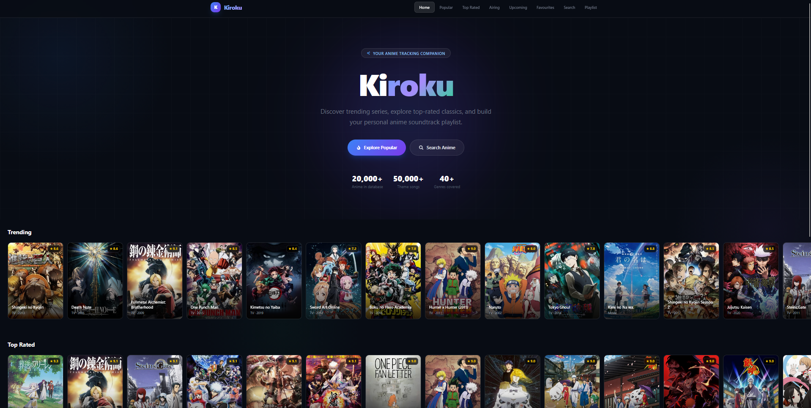
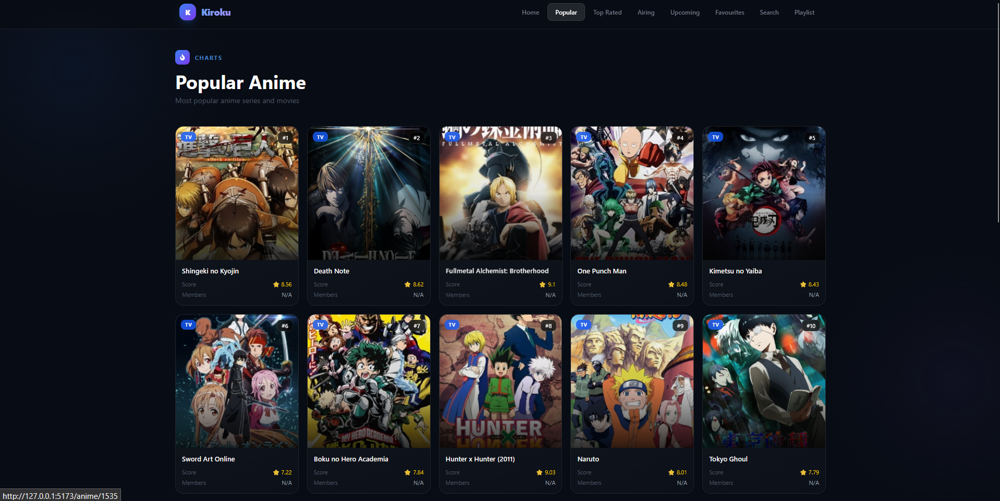
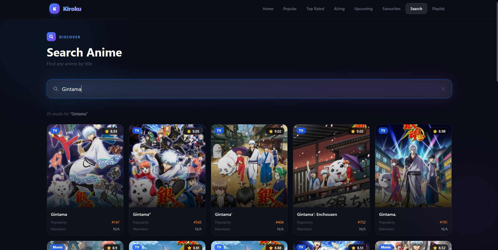
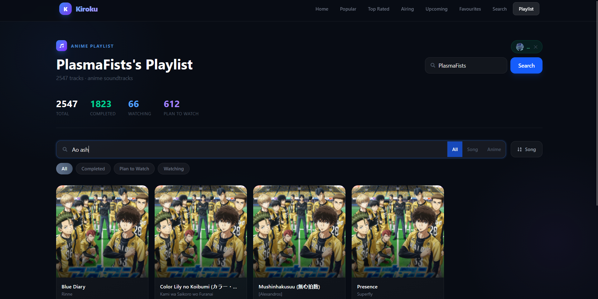
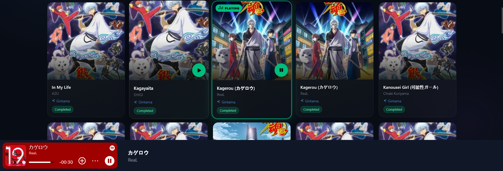
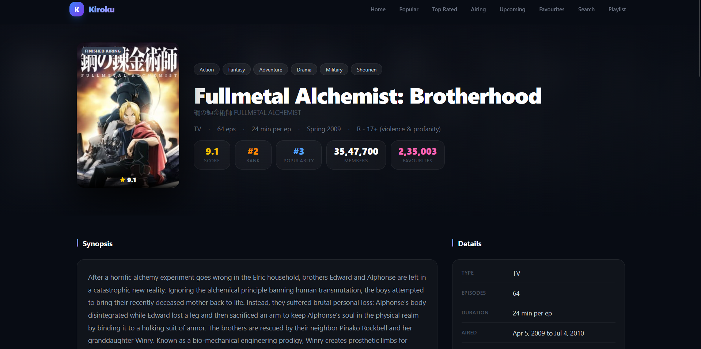
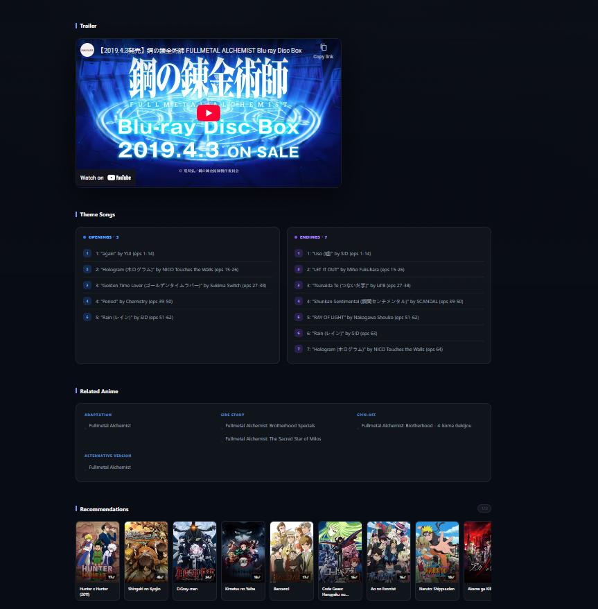

# Kiroku 記録

**Home Page**


**Popular Anime**


**Search**


**Playlist Maker**


**Spotify Player**


**Anime Details**



---

> A full-stack anime tracking and discovery platform with integrated Spotify soundtrack playlists.

Kiroku lets you browse and discover anime, track your watchlist, and listen to opening/ending themes through your own Spotify account — all in a modern, dark UI.

📖 **For system design diagrams, layer breakdowns, SOLID analysis, and interview talking points, see [ARCHITECTURE.md](ARCHITECTURE.md).**

---

## Features

- **Anime Discovery** — Browse popular, top-rated, currently airing, upcoming, and most-favourited anime
- **Search** — Full-text search across 20,000+ titles with infinite scroll
- **Anime Detail Pages** — Synopsis, information, trailer, characters & voice actors, theme songs, related anime, and recommendations
- **Playlist Maker** — Load any user's anime list and get a full soundtrack playlist from their watchlist, filterable by status and searchable by song or anime name
- **Spotify Integration** — OAuth 2.0 per-user authentication; playback uses the user's own Spotify token — app credentials never exposed to the browser
- **AI Chat Assistant** — local FastAPI + Ollama-powered KirokuBot for anime Q&A, recommendations, and streaming chat replies
- **Watchlist Tracking** — Track anime as Completed, Watching, or Plan to Watch with scores and quick status buttons directly from anime cards and list views

---

## Tech Stack

### Frontend
| Technology | Version |
|---|---|
| React | 19 |
| React Router | 7 |
| Tailwind CSS | 4 |
| Axios | 1.8 |
| Vite | 6 |
| react-icons | 5 |

### Backend
| Technology | Details |
|---|---|
| .NET | 9 (ASP.NET Core) |
| Python | FastAPI / uvicorn served by `backend/Kiroku.Chat` for the local anime chat assistant |
| Architecture | Clean Architecture (API / Application / Domain / Infrastructure / Data) |
| Database | PostgreSQL (via Entity Framework Core + Npgsql) |
| Cache | Redis (StackExchange.Redis) |
| Local AI | Ollama model inference via local `llama3.1:8b` integration |
| External APIs | Spotify Web API, Official MyAnimeList (MAL) API v2 |
| Docs | Swagger / OpenAPI |

---

## Project Structure

```
Kiroku/
├── frontend/                   # React 19 + Vite SPA (Tailwind CSS 4)
│   └── src/
│       ├── components/         # Shared components, Layout, Navbar, SpotifyBar
│       │   ├── common/         # Standardized AnimePageCommon primitives
│       │   └── soundtracks/    # SongCard, SpotifyConnectBanner, ExportSongsModal
│       ├── context/            # SpotifyContext, AuthContext
│       ├── hooks/              # useAnimeData (infinite scroll & caching)
│       ├── pages/              # Route-level page components
│       └── services/           # Centralized Axios API client with JWT interceptors
│
└── backend/
    ├── Kiroku.API/             # Controllers, Middlewares, Program.cs entry point
    ├── Kiroku.Application/     # Services, DTOs, interfaces (SOLID abstractions)
    ├── Kiroku.Domain/          # Domain entities (Anime, User, Character, Genre)
    ├── Kiroku.Infrastructure/  # External integrations (Spotify, Redis, BCrypt, JWT)
    ├── Kiroku.Data/            # AppDbContext, Migrations, Seeders
    └── Kiroku.Chat/            # Python FastAPI microservice (Ollama async streaming)
├── docs/                       # Developer documentation and guides
└── scripts/                    # Startup/stop scripts for local dev environment
```

---

## Getting Started

### Prerequisites

- [Node.js](https://nodejs.org/) 18+
- [.NET 9 SDK](https://dotnet.microsoft.com/)
- [PostgreSQL](https://www.postgresql.org/)
- [Redis](https://redis.io/)
- A [Spotify Developer App](https://developer.spotify.com/dashboard) with a redirect URI set to `http://127.0.0.1:5173/callback`

---

### Root helper scripts
From the repository root, these scripts help start and stop required local services:
```bash
npm run services
scripts\start-all-dev.cmd
scripts\stop-dev-services.cmd
```

`npm run services` will start Ollama, ensure the local model is downloaded, start Redis, and attempt to start the local FastAPI chat service in `backend/Kiroku.Chat`.
`start-all-dev.cmd` is a helper wrapper that also launches the same environment.
`stop-dev-services.cmd` shuts down Kiroku.Chat, Ollama, and Redis.

---

### Backend Setup

1. **Clone the repo and navigate to the backend:**
   ```bash
   cd backend
   ```

2. **Configure `appsettings.Development.json`:**
   ```json
   {
     "ConnectionStrings": {
       "DefaultConnection": "Host=localhost;Database=kiroku;Username=postgres;Password=yourpassword",
       "Redis": "localhost:6379"
     },
     "Spotify": {
       "ClientId": "your_spotify_client_id",
       "ClientSecret": "your_spotify_client_secret",
       "RedirectUri": "http://127.0.0.1:5173/callback"
     }
   }
   ```

3. **Apply database migrations:**
   ```bash
   cd Kiroku.API
   dotnet ef database update
   ```

4. **Run the API:**
   ```bash
   dotnet run
   ```
   The API will be available at `https://127.0.0.1:7171` with Swagger UI at the root.

5. **(Optional) Seed Database via CLI:**
   Populate or re-seed datasets anytime from the command line:
   ```bash
   dotnet run -- --seed             # Seeds users, lists, characters, and full anime catalog
   dotnet run -- --seed:users       # Seeds only test users and watchlist history
   dotnet run -- --seed:characters  # Seeds anime characters and voice actors
   dotnet run -- --seed:anime       # Seeds full anime dataset with checkpoint resumption
   ```

6. **Run the chat service (optional, for the Chat page):**
   ```bash
   cd backend/Kiroku.Chat
   python -m venv .venv
   .venv\Scripts\activate
   pip install -r requirements.txt
   uvicorn app:app --host 127.0.0.1 --port 8000 --reload
   ```
   The FastAPI chat service will be available at `http://127.0.0.1:8000`.

7. **Auto-start Ollama + model + Redis + Chat service:**
   ```bash
   npm run services
   ```
   This starts `ollama serve` if needed, pulls `llama3.1:8b` if it is missing, starts Redis on port `6379`, and ensures the local FastAPI chat service is running.
   If `redis-server` is not installed locally, the script falls back to a Docker container named `kiroku-redis`.

---

### Frontend Setup

1. **Navigate to the frontend and install dependencies:**
   ```bash
   cd frontend
   npm install
   ```

2. **Configure `vite.config.js`** to proxy API requests to the backend:
   ```js
   export default defineConfig({
     server: {
       host: '127.0.0.1',
       port: 5173,
       proxy: {
         '/api': {
           target: 'https://127.0.0.1:7171',
           changeOrigin: true,
           secure: false,
         },
         '/chat-api': {
           target: 'http://127.0.0.1:8000',
           changeOrigin: true,
           rewrite: (path) => path.replace(/^\/chat-api/, ''),
         }
       }
     }
   })
   ```

3. **Start the dev server:**
   ```bash
   npm run dev
   ```
   The app will be available at `http://127.0.0.1:5173`.

---

## Spotify Integration

Kiroku uses **OAuth 2.0 Authorization Code Flow** — each user connects their own Spotify account:

1. User clicks **Connect Spotify** → redirected to Spotify's login page
2. After authorizing, Spotify redirects back to `/callback` with a one-time code
3. The backend exchanges the code for tokens — the **refresh token is stored server-side in Redis**, never sent to the browser
4. The frontend holds only a short-lived access token **in memory** (never `localStorage`)
5. The access token auto-refreshes 2 minutes before expiry using the stored session ID
6. All Spotify API search calls pass the **user's own Bearer token** — the app's client credentials are never used for user-facing requests

This means Spotify API rate limits are per-user, not per-app, and the app scales without quota concerns.

---

## API Endpoints

| Method | Endpoint | Description |
|---|---|---|
| `GET` | `/api/v1/anime/popular` | Popular anime (paginated) |
| `GET` | `/api/v1/anime/top-rated` | Top rated anime (paginated) |
| `GET` | `/api/v1/anime/airing` | Currently airing anime (paginated) |
| `GET` | `/api/v1/anime/upcoming` | Upcoming anime (paginated) |
| `GET` | `/api/v1/anime/favourites` | Most favourited anime (paginated) |
| `GET` | `/api/v1/anime/search` | Search anime by title |
| `GET` | `/api/v1/anime/genre/{genreId}` | Anime by genre (paginated) |
| `GET` | `/api/v1/anime/studio/{studioId}` | Anime by studio (paginated) |
| `GET` | `/api/v1/anime/tags` | Tag list / genre metadata |
| `GET` | `/api/v1/anime/{id}` | Anime detail (full) |
| `GET` | `/api/v1/anime/{id}/characters` | Characters & voice actors |
| `GET` | `/api/v1/anime/{id}/themes` | Opening & ending songs |
| `GET` | `/api/v1/anime/{id}/recommendations` | Recommendations |
| `POST` | `/api/v1/user/login` | User login |
| `GET` | `/api/v1/user/{userId}` | User profile by ID |
| `GET` | `/api/v1/user/{userId}/anime-list` | User anime list by ID |
| `GET` | `/api/v1/user/by-username/{username}` | User profile by username |
| `GET` | `/api/v1/user/by-username/{username}/anime-list` | User anime list by username |
| `PUT` | `/api/v1/user/by-username/{username}/anime-list` | Add/update anime list entry |
| `GET` | `/api/v1/user/{username}/playlist` | User anime soundtrack playlist |
| `GET` | `/api/v1/spotify/song` | Search Spotify tracks |
| `GET` | `/api/v1/spotifyauth/login` | Get Spotify OAuth URL |
| `POST` | `/api/v1/spotifyauth/callback` | Exchange Spotify auth code for token |
| `POST` | `/api/v1/spotifyauth/refresh` | Refresh access token |
| `POST` | `/api/v1/spotifyauth/logout` | Revoke session |
| `POST` | `/chat` | Stream anime-only chat replies from the FastAPI chat service |
| `GET` | `/health` | Health check for the FastAPI chat service |

### Query & request parameters

- `page` (int) — page number for paginated list endpoints
- `per_page` (int) — page size for paginated list endpoints
- `query` (string) — search text for `/api/v1/anime/search`
- `genreId` (int) — genre MAL ID for `/api/v1/anime/genre/{genreId}`
- `studioId` (int) — studio MAL ID for `/api/v1/anime/studio/{studioId}`
- `type` (string) — optional tag type filter for `/api/v1/anime/tags`
- `limit` (int) — max number of tags returned by `/api/v1/anime/tags`
- `name` (string, required) — Spotify track name for `/api/v1/spotify/song`
- `artist` (string, optional) — Spotify artist name for `/api/v1/spotify/song`

### Body payloads

- `POST /api/v1/user/login`
  - `username`: string
  - `password`: string
- `PUT /api/v1/user/by-username/{username}/anime-list`
  - `animeMalId`: integer
  - `status`: string (`Watching`, `Completed`, `Plan to Watch`, `Dropped`)
  - `score`: integer
- `POST /api/v1/spotifyauth/callback`
  - `code`: string
  - `redirectUri`: string

---

## Environment Variables

Never commit secrets. Keep credentials in `appsettings.Development.json` locally (add to `.gitignore`) and use environment variables or a secrets manager in production.

```
# .gitignore
appsettings.Development.json
appsettings.Production.json
.env
```

---


## License

MIT
